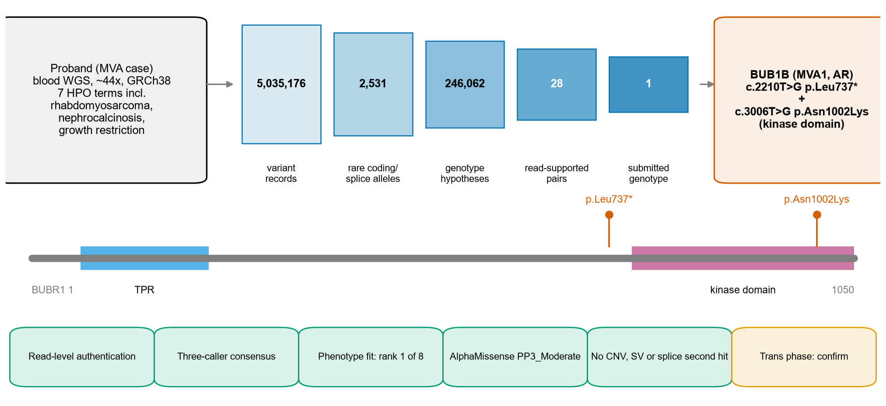

# Nexgene AI — MVA Hackathon 2026, Track 1

**Compound heterozygous *BUB1B* variants p.Leu737\* and p.Asn1002Lys in a child with mosaic variegated aneuploidy.**

İlsu Duman, Özge Beğli, Hatice Mutlu, Kutsal Baran Ozkurt*\
Nexgene AI ([nexgene.ai](https://nexgene.ai)). Contact: [kutsal.ozkurt@nexgene.ai](mailto:kutsal.ozkurt@nexgene.ai)

Team: Nexgene AI.



## Result

| GRCh38 | HGVS (MANE NM_001211.6) | Class | Key evidence |
|---|---|---|---|
| `chr15:40209701 T>G` | c.2210T>G, p.(Leu737\*) | stop-gain, exon 17/23 | NMD predicted (747 nt upstream of last junction); ClinVar P/LP two stars; gnomAD AF 7.4e-5 |
| `chr15:40220612 T>G` | c.3006T>G, p.(Asn1002Lys) | kinase-domain missense | AlphaMissense 0.923 (calibrated PP3_Moderate); 10 residues from MVA substitution L1012P; gnomAD AF 5e-7 |

The pair is the single row of [`submission/Nexgene-AI_mn5-evidence-v2.csv`](submission/Nexgene-AI_mn5-evidence-v2.csv) (SHA-256 `24162afe…`). From 5,035,176 variant records we built 246,062 genotype hypotheses and submitted this one row. The automated Track 1 scorer awarded it full rank points, so it agrees with the clinically confirmed answer.

The genotype matches the class that defines biallelic MVA1: a truncating allele in trans with a kinase-domain substitution that destabilises BUBR1 (Hanks et al. 2004; Suijkerbuijk et al. 2010). Both alleles are authenticated at read level, by an independent alignment, and by three-caller consensus (DeepVariant and Strelka2 PASS 0/1; GATK 0/1, unfiltered). *BUB1B* ranks first on phenotype alone and is the only MVA gene in this genome with two rare coding alleles. Copy-number, structural, splicing, published-allele and genome-wide aneuploidy screens found no competing explanation.

The alleles are 10,911 bp apart, so short reads cannot phase them. Parental genotyping or long reads, plus a BUBR1 abundance assay, are the recommended confirmatory steps.

## Report

- [Methods and evidence report (Markdown)](submission/Nexgene-AI_track1_report.md)
- [Methods and evidence report (PDF)](submission/Nexgene-AI_track1_report.pdf)
- [Organiser methods form](submission/Nexgene-AI_methods_description.xlsx)
- Figures: [`submission/figures/`](submission/figures/), as PNG, PDF and SVG. Regenerate with `python scripts/60_figures.py`.

## Repository layout

| Path | Contents |
|---|---|
| `submission/` | CSV prediction, report (MD + PDF), methods form, figures |
| `results/evidence/` | Six-gene and aggregate evidence tables behind every number in the report; provenance in `docs/evidence_index.tsv` |
| `scripts/mn5/` | MareNostrum 5 alignment, annotation, scoring, pairing, read-validation and phasing jobs |
| `scripts/supplement/`, `scripts/wave3/`, `scripts/rigor/` | Later MN5 and local evidence stages (CNV/SV, splicing, aneuploidy, QC, controls) |
| `scripts/` | Local stages, validators, figure and PDF builders |
| `docs/` | Pre-registration, dated deviations, lineage, data access, methods landscape review |
| `config/` | Tool versions, container digests, path template |

## Reproduce

Raw FASTQ, BAM, VCF and clinical text are controlled and are not shipped. A full rerun requires authorised hackathon access (`docs/data_access.md`).

1. Map the authorised inputs in `config/paths.example.yaml`. On MareNostrum 5, export `MVA_BASE` to the work root (required; there is no default) and, for the gnomAD fastpath job, `MVA_SOURCE_VCF` to the organiser VCF. Check input hashes against Appendix A of the report and `docs/lineage.md`.
2. On MN5, run the jobs in `scripts/mn5/` in the order listed in Appendix A, then the structural, splicing and QC dispatchers.
3. Run the local stages:

```bash
python scripts/validate_submission.py submission/Nexgene-AI_mn5-evidence-v2.csv <authorised>/GRCh38_no_alt.fa
python scripts/36_release_checks.py submission/Nexgene-AI_mn5-evidence-v2.csv submission/Nexgene-AI_track1_report.md submission/Nexgene-AI_methods_description.xlsx
python scripts/60_figures.py
python scripts/61_build_pdf.py
```

File digests are listed in `MANIFEST.sha256`.

## Funding

This work was supported by the EuroHPC Joint Undertaking, which awarded access to the MareNostrum 5 supercomputer hosted by the Barcelona Supercomputing Center (BSC-CNS), Spain, under awarded project ID **EHPC-AIF-2026PG01-1286**.

## AI disclosure

All analyses were carried out on Nexgene AI's Arf Machine research platform, on a local workstation and on MareNostrum 5. The language-model component was ASA-W1, Nexgene AI's medical-reasoning model, running locally. No patient data were used to train or fine-tune any model, and no patient data were exported from the local environment. Public database queries contained only a gene symbol, a single variant notation or a publication identifier. Data-use conditions were followed. Controlled source data and derived patient files will be deleted, with all copies, within 30 days of hackathon close, and the organisers will be notified. All AI-assisted interpretation was reviewed by the authors.

## License

The submission, report and figures are released under CC BY 4.0, as the hackathon rules require. Code is released on the same terms, except where a copied file carries its own upstream licence (for example `scripts/figstyle.py`, MIT); see `LICENSE`. External reference data and software keep their original licences. This is a research analysis, not a clinical diagnostic report.
